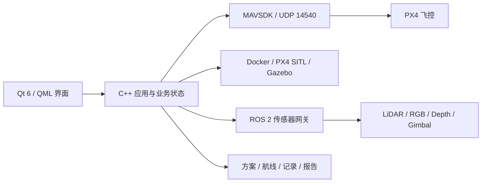

<p align="center">
  
</p>

<h1 align="center">FlightRig</h1>

<p align="center">
  面向 PX4 软件在环仿真的桌面测试与可视化平台
</p>

<p align="center">
  
  
  
  
  
</p>

FlightRig 将 Docker、PX4、Gazebo、ROS 2 与 MAVSDK 的分散操作整合到一个 Windows 桌面应用中，用于配置仿真环境、控制无人机、规划航点任务、查看传感器数据，并保存可回放、可验收的飞行记录。

> [!IMPORTANT]
> 当前版本仅面向本机 PX4 SITL 软件仿真，不提供真实无人机连接能力，也不应直接用于真实飞行。

## 为什么开发 FlightRig

常见的 PX4 仿真实验需要分别操作 Docker、飞控、仿真世界、ROS 2 数据服务和地面站。初学者不仅要记住多套命令，出现镜像缺失、启动超时、连接中断或传感器无数据时，也很难判断问题发生在哪一层。

FlightRig 把一次测试整理成可观察的完整流程：

1. 选择测试方案、飞行器和仿真场景。
2. 检查 Docker、镜像、容器与起飞条件。
3. 启动 PX4 SITL，并连接 MAVSDK 遥测。
4. 执行自由飞行、键盘控制或航点任务。
5. 查看雷达、相机、建图与巡检结果。
6. 保存飞行记录、原始数据和 HTML 测试报告。

## 主要功能

### 仿真与飞行

- 支持 `x500`、`x500 Depth`、`x500 Mono Camera`、`x500 LiDAR` 和 `x500 Gimbal` 五类飞行器。
- 提供 14 个经过整理的中国城市场景，以及开阔默认场地。
- 实时显示位置、姿态、航向、速度、电池、GPS 和飞行模式。
- 支持起飞、降落、返航、机体系键盘控制和精确转向。
- 起飞前持续检查传感器、位置、Home 点和 PX4 解锁许可。

### 航点任务

- 在二维地图中添加、拖动和编辑航点。
- 设置相对高度、飞行速度、航向角和任务结束动作。
- 保存、加载和复用航线，并检查已知建筑碰撞风险。
- 执行过程中监控任务进度、航线偏差、遥测中断和停滞状态。

### 传感器与建图

- LiDAR：实时雷达、二维 SLAM、位姿图回环优化和 ROS 地图导出。
- 深度相机：彩色/深度画面、三维障碍融合、PLY/OBJ/CSV/俯视图导出。
- 单目相机：实时画面、截图、录像和视觉巡检影像地图。
- 云台相机：角度控制、目标坐标锁定和多角度巡检采集。
- 传感器可选择“不使用、仅预览、预览并记录”，不需要时不会启动 ROS 2 容器。

### 测试记录

- 启动仿真后自动建立飞行记录，保存事件和可配置频率的遥测 CSV。
- 按测试规则给出“通过、有警告、未通过、用户结束”等结论。
- 在原飞行界面中同步回放轨迹、遥测、任务和传感器数据。
- 生成包含指标、验收表、趋势图、轨迹和事件的本机 HTML 报告。
- 支持 ZIP 数据包导出、回收站和批量删除。

## 软件结构



| 层次 | 主要职责 |
| --- | --- |
| Qt 6 / QML | 页面、弹窗、抽屉、二维地图、三维场景和实时状态展示 |
| C++20 | 飞行、任务、传感器、测试流程、数据持久化和外部服务管理 |
| MAVSDK | PX4 连接、遥测、动作、任务与 Offboard 控制 |
| Docker / Gazebo | 隔离运行 PX4 SITL、仿真世界和传感器模型 |
| ROS 2 | 转发 LiDAR、RGB、深度和云台数据 |
| CTest | 核心逻辑、数据处理、界面冒烟和部分 SITL 流程验证 |

更完整的源码职责划分见 [架构说明](docs/architecture.md)。

## 下载和运行

### 直接体验

下载 [FlightRig v0.13.0 Windows 发布包](https://github.com/yuanty344-bit/FlightRig/releases/download/v0.13.0/FlightRig-0.13.0-win64.zip)，解压后运行 `FlightRig.exe`。

运行前需要：

- Windows 10 x64。
- Docker Desktop 正常运行。
- 本机已有 `px4io/px4-sitl-gazebo:latest` 镜像。

如果镜像尚未安装，可在 PowerShell 中执行：

```powershell
docker pull px4io/px4-sitl-gazebo:latest
```

### 启用 ROS 2 传感器

发布包附带传感器网关构建文件。需要使用 LiDAR、单目、深度或云台实时数据时，先运行：

```text
scripts\build-ros-sensor-image.cmd
```

脚本会生成 `flightrig/ros-sensor-bridge:0.13.0`。普通 PX4 仿真不需要构建该镜像。

### 第一次使用

1. 打开 FlightRig，进入“准备”。
2. 创建测试方案，选择飞行器、场景、起飞高度和执行方式。
3. 在“运行环境”中确认 Docker 与 PX4 镜像状态。
4. 需要传感器时，主动开启“ROS 2 传感器数据”。
5. 点击“启动仿真”，等待飞行器连接和起飞检查稳定。
6. 明确确认后解锁起飞。

## 从源码构建

推荐环境：

- Qt 6.11.1，MSVC 2022 64-bit Kit。
- Visual Studio 2022 / MSVC 19.44。
- CMake 3.25 或更高版本。
- MAVSDK 3.17.1 Windows x64。

首次使用命令行时设置本机路径：

```powershell
$env:FLIGHTBENCH_QT_ROOT = "你的 Qt MSVC 目录"
$env:MAVSDK_ROOT = "你的 MAVSDK 目录"
cmake --preset windows-msvc-release
cmake --build --preset windows-msvc-release
```

日常开发建议直接在 Qt Creator 中打开 `CMakeLists.txt`，选择 **Qt 6.11.1 MSVC2022 64bit** Kit。不要使用可能来自其他软件的 Qt 5 `qmake`。

生成可独立运行的 Windows 发布包：

```powershell
.\publish-release.cmd
```

## 测试

运行不依赖真实 SITL 的测试：

```powershell
ctest --test-dir build-msvc --output-on-failure -E "FlightBench\.Sitl"
```

SITL 测试覆盖 Docker、MAVSDK、遥测、起降、键盘 Offboard、精确转向、航点任务、飞行记录和容器清理。SITL 测试需要 Docker Desktop 与对应镜像，并会使用独立临时容器和数据目录。

测试通过只能说明已覆盖的场景符合预期，不代表所有环境和功能完全没有问题。

## 数据位置

用户数据默认保存在：

```text
文档\FlightRig
```

其中包括测试方案、航线、飞行记录、传感器数据、截图、录像、地图和报告。删除仓库或程序不会自动删除这些数据。

## 已知边界

- 只接受本机 PX4 SITL 的 MAVSDK 连接，不支持真实飞行器串口或远程网络选择。
- 城市建筑、道路、绿地和水面来自 OpenStreetMap 数据与简化白模，不等同于测绘级场景。
- LiDAR SLAM 和深度融合用于仿真测试与结果观察，不作为真实环境中的安全避障保证。
- 云台目标锁定基于已知场景坐标和姿态，不是通用目标识别算法。
- 自动化测试不能替代不同电脑、Docker 版本和完整仿真流程的实际验收。

## 目录概览

```text
src/          C++ 应用、飞行、任务、测试、记录、传感器与基础设施
qml/          公共控件、功能页面、主页面与应用外壳
simulation/   Gazebo 世界、模型、地图和建筑安全数据
docker/       PX4 与 ROS 2 传感器网关相关文件
scripts/      镜像、发布、城市数据和资源生成脚本
tests/        C++、QML 与 SITL 测试
docs/         架构及开发说明
```

## 许可与数据来源

- FlightRig“门径”应用图标为本项目原创设计。
- 界面功能图标来自 Lucide，许可见 `resources/licenses/LUCIDE_LICENSE`。
- 城市场景包含 OpenStreetMap 数据，每个场景的归属说明位于对应模型目录的 `ATTRIBUTION.md`。

